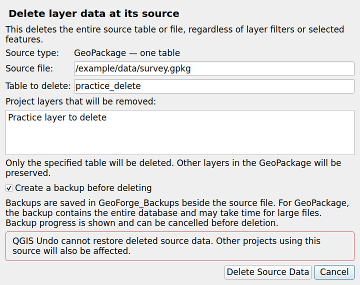
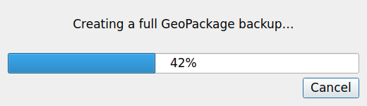

# Layer Eraser

**Delete a layer's source data and remove its project references from the QGIS Layers panel.**

Layer Eraser adds **Delete Layer and Source…** immediately after **Remove Layer** in a layer's context menu. A confirmation dialog shows the source file, the actual GeoPackage table name, and every project layer reference that will be removed. Backups are enabled by default.

Maintained by **GeoForge Studio**. Version **0.2.2**. Licensed under **GPL-3.0-or-later**.



## What it deletes

| Source | Deletion scope |
| --- | --- |
| GeoPackage | The selected vector or attribute table and its driver-managed geospatial metadata. Other tables and the container file are preserved. |
| Shapefile | The `.shp` file and recognized companion files, including `.dbf`, `.shx`, `.prj`, `.cpg`, and spatial/attribute indexes. |
| GeoJSON | The standalone GeoJSON file and its dedicated `.aux.xml` companion, if present. A `.json` file must actually use the GeoJSON driver. |

The operation applies to the **entire source table or file**, even when the layer is filtered or only some features are selected. Other projects using that source will also be affected. QGIS Undo cannot restore deleted source data.

Independent files with the same stem, such as CSV, TIFF, QML, and SLD, are preserved. Rasters, File Geodatabases, PostGIS, web services, archived files, memory layers, views, and SQL-result layers are outside this release's scope.

## Install

1. Download `layer_eraser-0.2.2.zip` from a release.
2. In QGIS, open **Plugins → Manage and Install Plugins → Install from ZIP**.
3. Select the plugin ZIP without extracting it and install **Layer Eraser**.
4. Right-click one supported layer in the **Layers** panel.

If you installed the earlier **GeoForge Source Delete 0.1.0** prototype, uninstall or disable it first. Layer Eraser uses the new Python package name `layer_eraser`.

The full GitHub source archive is a development project, not the installable plugin ZIP.

When upgrading an earlier Layer Eraser version, install the new ZIP and restart QGIS so the updated Python modules are loaded. For layers already marked invalid by 0.2.0, see [repairing an existing connection](docs/USER_GUIDE.md#repairing-an-existing-connection).

## Use

1. Select one layer and choose **Delete Layer and Source…**.
2. Check the source path, table name, and affected project references.
3. Leave **Create a backup before deleting** enabled, or explicitly disable it.
4. Choose **Delete Source Data**, or **Cancel** to leave the source unchanged.

Cancel is the default button. Selecting a group or multiple layers does not initiate a recursive or batch deletion. Multiple references to the same underlying source are identified automatically.

## Backups and recovery

Backups are saved in `GeoForge_Backups/<UTC timestamp>_<identifier>` beside the source. Each backup includes `deletion_manifest.json` describing its original source and the intended deletion.

- **Shapefile or GeoJSON:** copy the backed-up files to their original locations and add the layer to QGIS again.
- **GeoPackage:** open the backup in Browser and import **only the deleted table** back into the original database. Avoid replacing the whole database if other tables have changed since the backup.

A GeoPackage backup contains the **whole database**, including committed WAL data. It therefore needs disk space and time proportionate to that database. Progress is shown during backup; **Cancel** stops before deletion and removes the partial copy. Cancellation is disabled once deletion starts. If backup creation fails, deletion does not proceed. Recovery is manual; this release does not add an Undo or Restore button.



## Checks before deletion

Layer Eraser stops when a relevant layer is being edited or is protected from removal, when a source changes after confirmation, or when it finds a supported dependency. Checks cover project joins, relations and layer dependencies, plus GeoPackage foreign keys, related-table relationships and dependent views/triggers.

GeoPackage table deletion uses a GDAL transaction. Named surviving layers keep the same provider objects and source URIs; their data caches are synchronized without assigning invalid sources or reconstructing layer XML. Index-based surviving sources are converted directly to table-name sources so saved projects still open the intended tables. Standalone file bundles are staged on the same filesystem so an unsuccessful move can be rolled back, and their saved layer configuration is restored after failure. File locks are reported rather than bypassed.

The checks do not discover references in other closed projects or every possible application-specific SQL dependency. See [the user guide](docs/USER_GUIDE.md) and [validation report](docs/VALIDATION.md).

## Compatibility

| Item | Status |
| --- | --- |
| Minimum declared QGIS version | 3.34 |
| Local test environment | QGIS 3.34.4, GDAL 3.8.4, Python 3.12, Qt 5 / PyQt5 on Ubuntu 24.04 |
| Required QGIS 4 checks | QGIS 4.0.3 and 4.2.3 with Qt 6 in official Debian Trixie images |
| Windows and macOS | Intended platforms; not yet exercised in the recorded test environment |
| Runtime dependencies | QGIS and its bundled GDAL only; no pip installation, account, or network service |

The same plugin ZIP supports QGIS 3 and 4. A release requires all 50 real-file/provider/widget tests on QGIS 3 and both QGIS 4 images, plus a clean Bandit scan. The runner asserts the actual QGIS series and Qt major version. See the [validation report](docs/VALIDATION.md) and [current Actions results](https://github.com/geoforge-studio/layer-eraser/actions); declared bounds do not imply testing every version or operating system.

## Try the sample project

Copy the complete [examples](examples) directory to a writable location. Open `Layer_Eraser_Practice.qgz`. Delete `practice_delete` and check that `keep` remains readable. The project also contains separate GeoJSON and Shapefile practice layers. All coordinates and attributes are synthetic.

## Develop and test

The runtime package is `layer_eraser/`. Tests and examples remain outside the installable plugin.

From the repository root, using QGIS' Python environment:

```sh
QT_QPA_PLATFORM=offscreen python3 -X faulthandler -m unittest discover -s tests -v
```

Build the installable ZIP using standard Python, without third-party build dependencies:

```sh
python3 scripts/build_plugin.py
```

The build validates release metadata, English source text, required files, and source/package equivalence. Output is placed in the ignored `dist/` directory. See [architecture](docs/ARCHITECTURE.md), [contributing](CONTRIBUTING.md), and [publishing](docs/PUBLISHING.md).

## Report a problem

Use the [issue tracker](https://github.com/geoforge-studio/layer-eraser/issues). Include QGIS/GDAL versions, operating system, source format, exact error text, and a minimal synthetic dataset where possible. Do not post confidential source data or credentials.

Source code and releases are hosted at [geoforge-studio/layer-eraser](https://github.com/geoforge-studio/layer-eraser). The GitHub workflow tests and packages each change; a successful push to `main` publishes a release for a new version. Existing releases are never replaced automatically. Submission to the QGIS plugin catalog is a separate step.
